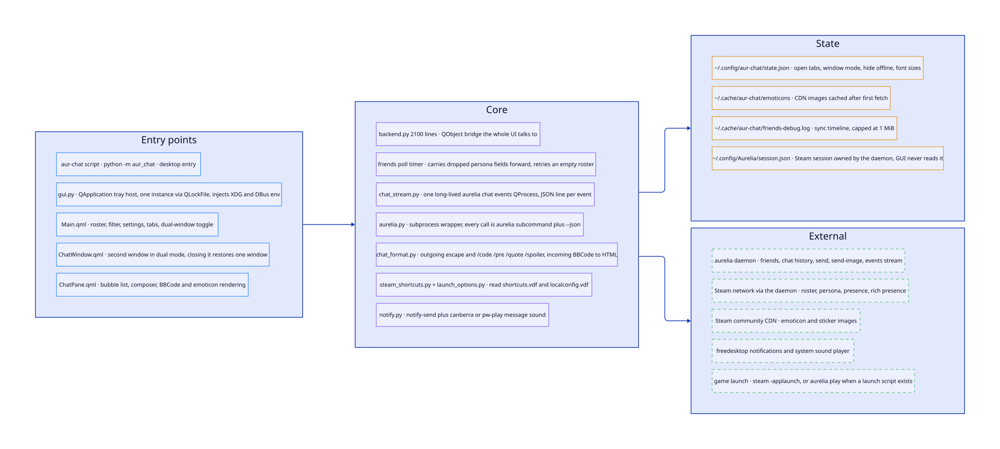

# aur-chat — how it works

A Qt/Kirigami Steam chat front end that owns no Steam code: it draws the friend list and chat bubbles, and every actual operation is a `--json` subprocess call into the `aurelia` daemon.

Read it left to right:

- **Nothing here talks to Steam.** `aurelia.py` is a thin subprocess wrapper — friends, history, send, send-image are all `aurelia … --json` calls handled by the daemon, which owns the one logged-in session. That is why the icon can live in a tray without a Steam client running, and why the GUI never sees a credential.
- **Incoming chat is one stream, not one watcher per friend.** `chat_stream.py` keeps a single long-lived `aurelia chat events --json` process and turns each stdout line into a Qt signal tagged with its source SteamID. The older design (one `chat open` watcher per open tab) is gone; opening ten chats costs ten QML tabs, not ten daemon sessions.
- **The roster is polled, and the poll assumes the daemon is imperfect.** An empty roster is retried before the list is emptied, persona fields a partial sync dropped are carried forward from the previous poll, and a landslide of simultaneous offline flips is collapsed into one summary notification instead of a storm.
- **Formatting is split by direction.** Outgoing text is escaped (`[` and `\`) and `/code`, `/pre`, `/quote`, `/spoiler` become Steam BBCode — everything else is sent as typed and formatted by Steam's server. Incoming BBCode is converted to HTML for the bubble, with emoticon images fetched once from the Steam CDN and cached under `~/.cache/aur-chat/emoticons`.
- **Persisted state is deliberately small.** Open tabs, dual-window mode, hide-offline and the two font sizes go to `~/.config/aur-chat/state.json`; the session lives in `~/.config/Aurelia/session.json` and belongs to the daemon. Both sides also keep a capped friends-sync log, which is the first place to look when rosters go strange.

Diagram source: [`docs/system.d2`](docs/system.d2) · render with [`scripts/render-diagram.sh`](scripts/render-diagram.sh) (writes `docs/system.svg` and `docs/system.png`).
